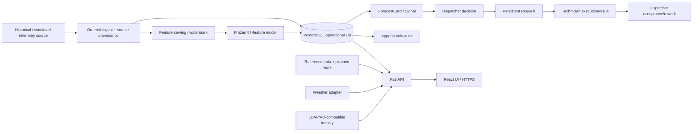

# Architecture

## System boundary

T.G.O.A.T. is decision-support software. It observes registered telemetry, computes a frozen generic 24-hour proxy risk, presents evidence and recommendations, records a human decision and carries inspection/maintenance work to a recorded outcome.

## Persistence

Normal operational mode uses PostgreSQL through a shared Unit of Work/repository layer. Prediction/card, human workflow and idempotency invariants rely on PostgreSQL constraints/locking rather than a process-local mutex. Startup/migration is fail-closed if the required operational database is unavailable.

Historical Replay remains an intentionally isolated/resettable SQLite session. Feature-state storage is separate from operational human workflow persistence and does not change the frozen ML contract.

## ML boundary

The frozen model predicts a generic proxy alarm/anomaly onset over the next 24 hours. It does not prove a physical fire, flooding event, intrusion or equipment failure. Scenario analysis therefore uses observed sensor evidence/history, freshness, planned-work and available external context and keeps `physical_incident_probability = null`.

## Workflow identity

- Prediction: exact object/model/assessment identity.
- ForecastCard: one model episode.
- Signal: human-work projection keyed to the card.
- Decision: immutable exact prediction basis selected by the operator.
- Request: persistent work item that survives later model score changes.
- Result/revisions: technician evidence and dispatcher acceptance/rework.

Frequent model updates do not reset existing human work.

## Security boundary

Authorization is server-side capability + scope. Roles/groups may compose. IS administration does not automatically imply dispatcher command rights. Synthetic map geography is never an authorization source.

Normal-mode audit is PostgreSQL-backed and append-only. Critical domain mutations and their audit record share the Unit of Work. Authentication secrets/tokens are excluded from audit content.

## Integration boundary

Customer-protected systems are modeled as read-only external boundaries. The repository includes simulators/adapters for telemetry, equipment registry, work status, weather and LDAP-compatible identity so the software contract can be tested without claiming a real protected connection.

## Time and replay

All serving paths are bounded by an explicit `as_of`/committed watermark. Future telemetry must not leak into historical/replay/scenario views. Historical Replay performs five-minute frozen inference and backpressures authoritative virtual time to completed processing.
